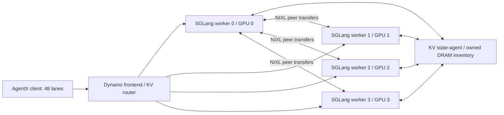
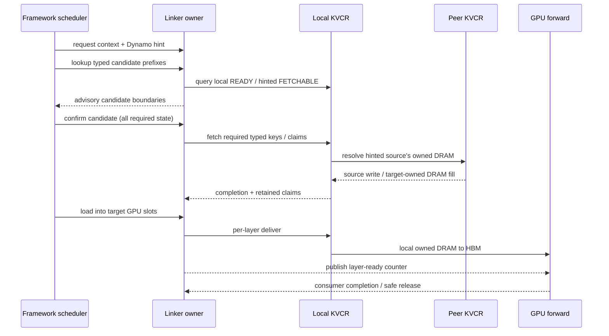

# GB300 KVCR linker: implementation, cache layout and measured optimizations

This document describes the **completed historical Qwen3.8 direct-device linker
experiments**, including their actual integration patches. It does not describe
an unmodified modern KVCR checkout or claim results for the unlaunched PR45650
repeat. Read [the comparison](comparison.md) for measured outcomes and attribution
limits; use [manual reproduction](manual-running.md) to start components.

## 1. Scope and exact implementation

The measured serving stack is:

| Component | Recorded source/version |
|---|---|
| SGLang fork base | `ziqifan617/sglang`, `5b65e088969b872b924355d20a329e9816a1b094` |
| KVCR fork base | `linhu-nv/kvcr`, `3d8c9b831e8fde161d510ac233550314724880e9` |
| Dynamo PR17655 | `3f0ef62c22ce2e212fd7a6394ef98d84f5f9a23b` |
| Model and draft | `nvidia/Qwen3.8-Flash-Next-NVFP4`, `fc694b54fb0174e0913e6adf86691ef85a4ead47` |
| Transport | NIXL/nixl-cu13 1.5.0 over UCX; one allocated RoCE RNIC |
| Client | AgentX/AIPerf1.0.12 with pinned HF trace loader |

Every stage has exact argv/environment, settings, source patches and an official
client export in `stages/<stage>/`. Full patches in `patches/<stage>/` apply to
these clean pinned HEADs. Reconstructed changed source is in `code/<stage>/`.

“Baseline” means the completed **no pool-index** experiment, with required Qwen
compatibility, cache-mode handshake, telemetry/owner instrumentation and the
native progress fixture already present. It does not mean zero local changes.
The baseline KVCR patch selects native `num_threads=0`; the NIXL background
progress thread remains enabled. Profiling instrumentation is part of this
historical baseline and is not retroactively removed from the reproduction.

## 2. Placement and service topology

Four GB300 workers run inside one aarch64 GPU pod, one GPU each, all TP/DP/EP/PP/CP
sizes1. Dynamo frontend and state-agent run alongside them. This is same-node
cross-worker RDMA through one assigned HCA, not a cross-node acceleration test.



The KVCR storage owner in these tests is **in-process**:
`kvcr_service_socket_path=null`, not a separate Guard service. Each worker has a
linker owner thread, a KVCR client/runtime and128GiB of owned DRAM. It registers
framework GPU tensors and its own DRAM pools. PLE64GiB/worker is requested model
embedding/offload data, separate from the128GiB KVCR budget. The independent
framework HiCache host controller is disabled. Do not describe this as the older
vLLM framework-host-cache → Guard staging design.

The router uses the two-tier cost policy, cache threshold0.5, absolute balance
threshold4 and relative threshold1.1, with TCP requests, ZMQ events and file
discovery. KVCR publishes owner-scoped cache inventory through the integration.
The router hint is advisory; final physical-key claims decide usable readiness.
The captured implementation selects one source fetch action per hint envelope,
not arbitrary per-pool multi-source fanout.

## 3. What is cached

The model has12target full-attention layers and36linear/Mamba layers. Its NEXTN
configuration adds one full-attention draft layer. A reusable prefix needs more
than attention KV:

| Logical state | Physical representation in this experiment | Indexing / readiness |
|---|---|---|
| Target + draft K/V |13layers ×2buffers, BF16;64KiB per piece/page | KV-page indices; all required uncached tail pages |
| Compressed attention indexer |13buffers;4KiB per piece/page | Derived from the same logical64-token KV page |
| Mamba temporal state |36pieces ×1,572,864bytes/checkpoint | Checkpoint-slot index |
| Mamba convolution state |36pieces ×61,440bytes/checkpoint | Same checkpoint slot |
| Registered PLE/window state |1piece ×184,320bytes/checkpoint | Same checkpoint slot |
| Request-wide history |1piece ×16bytes/checkpoint | Same checkpoint slot |

These counts are the captured Qwen geometry, not constants for every hybrid
model. One complete checkpoint consumes59,019,280bytes, about56.285MiB. One
complete KV+indexer page consumes1,757,184bytes, about1.676MiB. GPU Mamba slot
capacity480 and tracking interval256 are different parameters from the backend's
Mamba checkpoint capacity M.

The Qwen compatibility builder exports page-aligned tensor views without copying
noncontiguous tensors into detached storage. It includes target and packed draft
KV/indexer buffers and uses the same registered transfer-state entries as slot
CoW/PD transfer. ReplaySSM/speculative scratch is excluded. Mamba/PLE/history are
loaded at gate zero because some history is read before the decoder's layer
loop. The request pool receives the transfer counter as well as the KV pool.

See [`sglang/python/sglang/srt/mem_cache/hybrid_cache/`](https://github.com/hxieustc/sglang/tree/76b29b63408277c04e9554b8abbc8503673abd95/python/sglang/srt/mem_cache/hybrid_cache/) for the
actual Qwen builder and `.../registry.py` for counter registration. The resulting
states are not omitted by any capacity experiment.

## 4. Keys, pieces, pages and checkpoints

A storage key contains the model/layout namespace, logical pool name and prefix
hash. The namespace captures model path/revision/quantization/cache dtype,
parallelism and tensor geometry. A key can own multiple named physical pieces.
Registered descriptors bind piece labels to addresses, strides, counts and sizes.

Distinguish these units throughout analysis:

- A **logical token page** is64tokens in this model.
- A **typed storage key** is a KV, indexer or checkpoint identity at a prefix.
- A **physical piece** is one named tensor slice, often one layer/component.
- A **NIXL descriptor** describes a physical transfer interval; its count is not
  the number of logical token pages.
- A **complete checkpoint** includes all four Mamba/PLE/history physical families.

Direct-linker lookup intersects component-specific requirements. KV/indexer use
all required pages; checkpoint-like state is required at the selected candidate
endpoint. An earlier missing external KV page can be irrelevant if the worker
already has that part in HBM. A surviving checkpoint alone is not a complete
restorable prefix, and a logical router hit is not proof of every typed piece.

## 5. Fixed DRAM pools and allocation

`KVCRRuntime._pool_lengths` computes each physical region before registration.
Each region is a fixed-length mmap with its own slot accounting. The backend
tracks per-key residency, claims/readers/writers, evictability and pool deficits.
Addresses remain stable while live operations use their descriptors.

Default allocation budgets complete page/checkpoint groups together, producing
M=K=2261 for this128GiB geometry. Most bytes go to large checkpoints:

| Configuration | Mamba checkpoints | KV/indexer pages | Mamba reserved GiB | KV/indexer reserved GiB |
|---|---:|---:|---:|---:|
| Default / M2261 |2261|2261|124.278|3.700|
| Explicit M2176 |2176|5129|119.606|8.394|
| Explicit M1536 |1536|26625|84.428|43.572|

Reservation is not RSS or observed READY data. Complete-page rounding may leave
a small part of the configured budget unused. Capacity arithmetic is approximately:

```python
checkpoint_bytes = M * bytes_per_complete_checkpoint
K = floor((128 * GiB - checkpoint_bytes) / bytes_per_complete_kv_indexer_page)
```

Free checkpoint slots cannot satisfy a KV-pool allocation. Moving bytes between
registered typed regions safely would require allocator/descriptor changes,
not merely changing a counter. The capacity options preserve all checkpoint
components and alter only counts/partitioning.

For context, B200 M2048 used224GiB/worker,112.570GiB checkpoint reservation and
111.430GiB KV/indexer reservation, yielding68090pages. It is not an additional
point on a same-hardware128GiB GB300 M sweep.

## 6. PUT path, ownership and eviction

The following is conceptual pseudocode; exact code is bundled per stage.

```python
# Scheduler / producer side
transfers = logical_pool_transfers(prefix_pages, checkpoint_slot)
snapshot_indices_and_keys(transfers)        # preserve GPU slot lifetime
ready = record_producer_cuda_event()
owner.enqueue_offload(transfers, ready)

# Linker owner
if ready.query() and no_conflicting_load_hazard:
    pieces = layout.prepare(transfers)      # KV, indexer, full checkpoint
    for bounded_batch in group_complete_keys(pieces,
                        max_bytes=512 * MiB, max_descriptors=4096):
        op = kvcr.deposit(bounded_batch)
        retain_batch_ownership_until_terminal(op)

# KVCR progression
allocate_required_typed_slots()
evict_eligible_whole_keys_if_needed()        # respect claims and readers/writers
submit_gpu_to_owned_dram_copy()
on_success_publish_ready_inventory()
```

The original source already avoids recopying READY pieces and attaches to
existing writers. Therefore repeated local-fill bytes do not by themselves prove
“PUT copies already-READY data every time.” The measured dominant pattern was
re-admission after eviction. Remote admissions can also contribute inventory
adds; inventory byte flow and native local-copy payload have different scopes.

A key does not become safely reusable merely because allocation succeeded.
Pending copies, cancellation and uncertain native DMA retain ownership until a
terminal/quiescent state. Eviction candidates must be eligible, and descriptor
references must not outlive their backing region/slot generation.

## 7. GET path: hint, confirmation, load and consumption



This distinguishes **direct-device linker integration** from the exact remote
route: confirmation can fetch peer data into local owned DRAM, then layer-wise
local delivery places it in HBM. The integration supports direct delivery paths,
but the name alone is not proof that every remote GET bypasses destination DRAM.
Do not rewrite these historical runs as a uniformly one-hop remote-DRAM→HBM path.

`lookup` may see advisory FETCHABLE state; `confirm_lookup` must acquire complete
required physical pieces and keep their claims. Failed candidates can retry
shorter prefixes; sparse checkpoints make this expensive. Load holds the GPU
slot ownership and releases claims only after the relevant transfer/consumer
lifetimes. Native DONE observation and layer-counter publication are distinct
boundaries.

The SGLang adapter's framework-pinning fallback immediately declines unresolved
source keys. It does not recreate the long vLLM caller handoff/pin-wait described
in older Guard tests. An unsuccessful source operation can therefore submit
**zero native bytes**. Source-operation failures are not synonymous with RDMA
transport failures. Historical native duration telemetry is success-only and
cannot establish zero transport faults.

## 8. Stepwise optimization design and measured outcomes

Every row is a separate completed1800s experiment. See `configuration-delta.json`
and `*-from-parent.patch` for exact deltas. Parent-relative code diffs are for
review; full source reconstruction uses one selected stage's full patches.

| Stage ID | Change / implementation | Mean TTFT ms | ITL ms | Output tok/s |
|---|---|---:|---:|---:|
| `kvcr-baseline` | Qwen-compatible no-index baseline |4260.858|82.282|559.683|
| `kvcr-pool-index-m2261` | Auxiliary per-physical-pool eviction index |1117.536|13.337|1626.866|
| `kvcr-m2176` | Same code; explicit checkpoint cap2176 |1114.331|12.769|1780.551|
| `kvcr-m1536` | Same code; explicit checkpoint cap1536 |810.548|7.698|1985.749|
| `kvcr-first-page-negative` | Mandatory-first-page known-miss fast path |825.270|7.838|1976.034|
| `kvcr-incremental-confirmation` | Reused encodings + incremental confirmation |802.134|7.402|1984.976|
| `kvcr-gil-1ms` | Process GIL switch interval1ms |791.982|7.516|2012.987|
| `kvcr-native-poll-1ms` | Native progress delay1000µs, background retained |710.722|7.524|2022.970|

### 8.1 Pool-aware eviction index

Problem: a single global eviction queue could repeatedly scan keys that own no
slots in the deficient physical pool. The fix mirrors the global relative
ranking in a queue for each physical pool. Insert/remove/score changes update
both. A single-pool admission uses that pool's queue; multi-pool admissions
retain the global queue. Claims, victim eligibility, whole-key eviction and
replacement policy remain authoritative.

```python
queue = per_pool[only_required_pool] if len(required_pools) == 1 else global_queue
for key in queue.candidates(protected_keys):
    evict_eligible_key_until_deficits_satisfied(key)
```

[`kvcr/src/kvcr/backends/local_dram_pools.py`](https://github.com/hxieustc/kvcr/blob/013955b73526a01b3f242da185f31deb41d14b5c/src/kvcr/backends/local_dram_pools.py) and its
bundled unit-test changes are the implementation. Capacity does not change at
this step. Mean TTFT falls73.8% versus baseline, although the tiny KV partition
still produces high re-admission/churn.

### 8.2 Capacity redistribution: M2176 and M1536

The source patches are identical across M2261/M2176/M1536; these are configuration
experiments. `mamba_checkpoint_capacity` reserves the requested number of complete
checkpoints, then budgets the remainder to KV/indexer pages. M1536 expands KV
capacity11.8× over M2261. No checkpoint tensor is truncated.

M2176 improves throughput but not aggregate TTFT tails. M1536 yields materially
better TTFT and cache reuse. It is a tradeoff: Mamba pools hit their limits during
23.6–39.2% of the window across workers. This is the best tested capacity point,
not proof that reducing M further would help or that1536fits every workload.

### 8.3 First mandatory-page negative fast path

When a previously confirmed miss is the first page required by every positive
candidate, rebuilding all shorter candidate windows cannot make that mandatory
page appear. The14-line fast path releases stale positive claims, retains the
known miss and returns false early. It does not generalize every later missing
checkpoint into a global miss and does not replace final physical validation.

The completed result did **not** improve aggregate TTFT or throughput over M1536.
A CPU-method improvement must not be advertised as a model-serving speedup.

### 8.4 Encoded/incremental confirmation, A+B

The next stage retains the first-negative path. It stores encoded vectors under
a request scope and lookup generation, checks layout identity/signature and
reuses them while confirming shorter candidate boundaries. Claims remain in the
existing claim owner; the encoding plan never owns a lease.

When the prior candidate's mandatory prefix is fully claimed and only the
checkpoint/window changes, update the required set for entering/leaving ranges
instead of re-encoding and rescanning the entire prefix. Release stale claims,
fetch newly required pieces and revalidate completeness. Layout/generation,
sharding, unsupported policies, pending confirmation operations or exceptions
fall back/invalidate the optimization.

The recorded implementation includes safeguards for request release/reset,
claim-set identity, sparse trailing windows and exact release ordering. Read the
full delta rather than replacing these with a generic cache of query results.
Aggregate results are mixed: mean TTFT802ms versus825ms first-negative, with p99
higher. No isolated causal TTFT-stage saving is established by subtracting sums.

### 8.5 Python GIL interval

`python_gil_switch_interval_seconds=0.001` calls `sys.setswitchinterval` inside each
worker and logs before/actual values. This affects scheduling across Python
threads in that worker process; it is not a per-thread lock, a CPU affinity
setting, a native progress delay or an RDMA bandwidth knob. Source/payload/layout
remain the A+B/M1536 parent. The GIL1ms result improves mean TTFT modestly but has
mixed p90/p99/ITL changes. Mooncake has its own separately measured GIL1ms control.

### 8.6 Native progress delay

`nixl_prog_thread_delay_us=1000` installs the bundled worker-local helper/SDK
wrapper overlay before KVCR constructs the NIXL agent. It passes native
`pthrDelay=1000`, with `useProgThread=true`, `useListenThread=true` and the other
constructor settings retained. It does not disable background progress or modify
the installed system SDK globally.

`software/sglang/python/sglang/srt/mem_cache/storage/kvcr/native_progress_delay.py` and
`_native_progress/{bridge.py,overlay/_api.py}` are essential code changes outside
the ordinary tracked linker diff. Both initial and post-clear agent generations
must log the actual constructor handoff. The selected delay reduces observed
mean TTFT to710.722ms; it remains slower than both historical Mooncake R3 and the
matched Mooncake GIL1ms control on mean/p90 TTFT. Tail comparisons depend on the
specific Mooncake control; see the comparison document.

## 9. Manual execution and expected checks

Follow all eight sections of [manual reproduction](manual-running.md), using
the chosen stage ID. The renderer emits separate commands for state-agent,
frontend, each worker, qualifier/cache clear, collector and AgentX. It retains
all flags in the recorded worker argv; the most important are:

| Area | Settings |
|---|---|
| GPU memory/model | `mem-fraction-static=.88`, BF16 KV/Mamba, modelopt_mixed |
| Request/cache geometry | context262144, page64, prefill/max16384, max-running96 |
| Mamba | extra_buffer_lazy, GPU480slots, tracking256; backend M is stage-specific |
| Speculation | NEXTN3steps/topk1/draft4; synthetic2.32/match-expected/real-draft-token |
| Linker | unified external linker enabled; backendkvcr; no independent HiCache host tier |
| KVCR |128GiB, socketnull, inventory/telemetrytrue, profile_ownertrue; timeout20s/abandon60s/startup300s |
| Transport | SGL1, UCX rc/self/cuda_copy, assignedRNIC, RNDV/EAGER/RMArails1, memtype_cachen |
| Router | two-tier0.5/4/1.1, file discovery, TCP/ZMQ |
| Client | pinned AgentX trace,48lanes,5extras+primers,1800s sending,30sgrace |

Required evidence includes actual pool bytes, semantic/native peer correctness,
four normal-hash model cards, actual source/import/wheel hashes and all stage
settings after cache clear. Capture raw failures and cancellation reasons.
Do not call all source failures RDMA errors, do not reuse a pending Guard result,
and do not silently replace this source stack with current main.

## 10. Reproduction boundary

The local bundle verifies changed tracked postimages and supplies native helper
extras, ignored-version metadata and supplementary CPU tests. It does not embed
entire repositories, model/trace payloads, native wheels or all original raw
archives. `evidence/patch-validation.json` documents what was checked. Supplemental
ignored files are labeled separately from raw archive membership. Source rebuild,
new hardware and manual orchestration require fresh functional/native/capture
qualification before new results can be considered valid.
