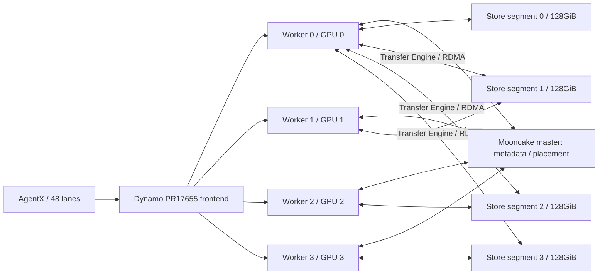

# GB300 Mooncake linker: implementation, cache organization and reproduction

This is the Mooncake companion to [the KVCR guide](architecture-kvcr.md). Both describe
the completed historical SGLang direct-device linker tests, not HiCache. The
[common manual procedure](manual-running.md) contains the exact environment,
source/bootstrap, component startup, validation, replay and collection sequence.

## 1. Source, package and measured controls

SGLang base is `5b65e088969b872b924355d20a329e9816a1b094` with the bundled Qwen,
Mooncake integration/instrumentation and cache-mode changes. Dynamo is PR17655
`3f0ef62c22ce2e212fd7a6394ef98d84f5f9a23b` with the same Python handshake patch
and native wheel hashes used by KVCR. The model, draft and trace revisions are
identical to the KVCR guide. Mooncake is package
`mooncake-transfer-engine-cuda13==0.3.13`.

| Stage | Historical attempt | Selected setting |
|---|---|---|
| `mooncake-baseline` | `gb300-router-control-r3` | local_first configured master, default GIL |
| `mooncake-gil-1ms` | `gb300-mooncake-gil-1ms-r1` | same original integration with explicit Python GIL1ms |
| `mooncake-random` | `gb300-mooncake-random-r1` | fresh measured random-placement control, default GIL |
| `mooncake-local-first` | `gb300-mooncake-local-first-r1` | fresh measured local-first control, default GIL |

The random/local-first pair is explicitly frozen and qualified on the same pod/
GPUs/HCA. The older baseline and GIL control are separate historical allocations;
they are not substituted for that pair when attributing an allocation-policy
change. Every stage has full patches, parent deltas, configs, actual argv/env,
source/build proofs and an official export in this folder.

## 2. Service topology

There are seven services: Mooncake master, Dynamo state-agent, Dynamo frontend
and four independent one-GPU SGLang workers. Each worker embeds a Mooncake client
and contributes128GiB of store DRAM,512GiB total. PLE64GiB/worker is separate model
data. The independent framework HiCache host controller is disabled.



The master is a control/metadata service; the actual payload uses the Transfer
Engine. `metadata_server=P2PHANDSHAKE` is the transfer metadata mode and does not
mean there is no Mooncake master. `standalone_storage=false` here means clients
contribute storage, not that the backend has no contributed memory.

The same Dynamo routing policy/transport/build is used for both backends. The
Mooncake lookup path can query its global store by object keys; it is not the
same protocol as KVCR's single hinted owner endpoint. Matching the router does
not make backend metadata/lookup/placement designs identical.

## 3. Shared model-state layout

Both linkers call the shared `resolve_hybrid_device_pool_group`. Thus Mooncake
also handles target/draft KV, compressed indexer data, Mamba temporal/convolution
state, registered PLE windows and request-wide history. The Qwen extension is
required for both. It does not omit Mamba/PLE to produce a faster number.

The GPU-state layout and readiness constraints are the same as those explained
in the KVCR guide:64-token pages; target12+draft1 full-attention layers;36Mamba
layers; complete checkpoint about56.285MiB. Mamba/history readiness must protect
pre-decoder consumers, not just the last model layer.

Object keys include model/backend tagging, component identity and parallelism
suffix information. A logical page can expand to multiple physical objects or
buffer pieces. The same key can be accessed for successive layer ranges. An
API's object count is therefore neither a token-page count nor a NIXL descriptor
count. Replica count is1 in these captures; this does not imply a given object
is stored on its requesting worker.

## 4. Memory organization: no fixed M checkpoint reservation

The configured store contribution is `global_segment_size=137438953472`bytes per
worker. Incoming KV/indexer/checkpoint objects consume this registered segment
budget according to object size, placement, admission and eviction. There is no
configured equivalent of KVCR's `mamba_checkpoint_capacity=1536`, nor a fixed
semantic reservation of124GiB for Mamba and3.7GiB for KV pages.

```text
Each contributed 128GiB segment:
  object allocation budget
    -> KV objects
    -> indexer objects
    -> Mamba/PLE/history objects
  actual mix changes with the admitted workload
```

This does not mean unbounded or perfectly fungible memory. Allocator size classes,
fragmentation, object overhead, placement eligibility and eviction affect actual
capacity. Large checkpoints still compete with smaller KV objects. A checkpoint
surviving after required KV eviction is still insufficient for a usable prefix.
The distinction is absence of the tested KVCR integration's hard semantic
partition, not immunity to cache pressure or a guarantee of an optimal mix.

The original B200 Mooncake control reached about90% aggregate allocation of its
896GiB budget. Fresh GB300 random/local-first peak at about90% of512GiB. These
are allocator occupancy measurements, not exact unique READY data, cache hit
rates or a measured global deduplication saving.

## 5. PUT/offload path

The producer constructs logical transfers, snapshots the source state/lifetime,
records a CUDA readiness event and hands the expanded pools to the offload
thread. That thread waits for producer readiness and calls `batch_set_v2`.
The storage adapter expands keys/buffer lists, checks existence and invokes the
appropriate zero-copy API for missing work.

```python
# Conceptual shape; review the actual stage snapshot for API/result details.
expanded = pool_group.resolve_transfers(logical_transfers, allow_partial=True)
ready_event.record()
offload_queue.put((expanded, ready_event))

# Offload thread
ready_event.synchronize()
objects = expand_physical_keys_and_registered_buffers(expanded)
missing = filter_objects_not_already_present(objects)
results = store.batch_put_from_multi_buffers(missing.keys,
                                            missing.ptrs, missing.sizes)
acknowledge_only_if_required_results_succeed(results)
```

Existing objects may satisfy a PUT without rewriting all accepted payload bytes.
Thus API accepted-byte totals are not automatically RDMA wire bytes. Master
placement selects an eligible segment; local_first prioritizes the local choice,
whereas random changes selection among eligible storage locations. Replicas1
and existence checks are separate from allocation policy.

Backend publication/lookup and device-cache events have different lifetimes.
Keep a model/backend key namespace stable across workers intended to share
objects, and isolate new model/test stores from unrelated live instances.

## 6. GET/load path and GPU destination

`lookup` calls `batch_exists_v2`, which tests all required component keys and
returns restorable prefix boundaries. The GPU tree can already cover an earlier
prefix, so the later load may contain only missing components. Load requests are
queued and merged into layer-wise batches.

```python
candidates = storage.batch_exists_v2(page_keys, expanded_pool_transfers)
selected = framework_selects_usable_candidate(candidates)
queue_missing_device_destinations(selected)

# Load thread
for pool_batch in batches:
    store.batch_get_session_start(pool_batch.keys)
try:
    for layer in target_transfer_layers:
        for pool_batch in batches:
            ptrs, sizes, offsets = prepared_layer_ranges(pool_batch, layer)
            copied = store.batch_get_into_multi_buffer_ranges(
                pool_batch.keys, ptrs, sizes, offsets)
            require_complete_byte_counts(copied, sizes)
        publish_layer_ready(layer)
finally:
    finish_started_sessions()
```

This linker registers the actual GPU allocation buffers and passes prepared GPU
pointers to range GET. The destination is HBM, unlike a framework HiCache
host-staging path. Backend source bytes can be local or remote store DRAM.
Explicit get sessions protect the read lifetime; incomplete sizes fail the load
and its layer counter rather than publishing partially ready state.

The loop over layers/pools is explicit in the adapter. A native batch can involve
multiple source objects, but these captures do not expose per-source overlapping
sessions. Do not infer all-source parallel transfer, fanout count or remote-only
batch bandwidth from an inclusive range_get record.

The key source file is
[`sglang/python/sglang/srt/mem_cache/storage/mooncake_store/mooncake_direct_linker.py`](https://github.com/hxieustc/sglang/blob/76b29b63408277c04e9554b8abbc8503673abd95/python/sglang/srt/mem_cache/storage/mooncake_store/mooncake_direct_linker.py);
`mooncake_store.py` contains key expansion, existence and SDK entry points.

## 7. Actual changes and policy controls

### Required baseline integration

The bundled full SGLang patch includes Qwen device-pool support, complete-state
transfer-counter registration, Mooncake linker/operation instrumentation and
existing backend compatibility changes. The Dynamo patch advertises actual
normal cache-key mode from scheduler metadata, despite NEXTN decoding. Without
it, router bigram/EAGLE mode can disagree with Mamba's normal prefix hashes.

`WITH_NVIDIA_PEERMEM=0` selects the qualified DMA-BUF registration path on this
GB300 environment. An earlier startup failed with GPU registration EFAULT/-600;
the successful control uses this explicit setting. It is an operational native
registration compatibility setting, not evidence of faster RDMA than another
registration path. Both require actual full-byte native peer validation.

### GIL1ms control

`python_gil_switch_interval_seconds=.001` is read/validated in the Mooncake linker
before passing the remaining options to storage. It sets `sys.setswitchinterval`
and records the actual value per worker. This is the matched scheduling control
for the KVCR GIL/native-poll experiments, not a requirement for baseline Mooncake.
It produced587ms meanTTFT versus543ms in the older baseline, with mixed metrics;
there is no general Mooncake speedup claim.

### Random versus local-first

`mooncake-random` and `mooncake-local-first` have identical serving source and
normal GIL. The measured experimental change is the master's
`--allocation_strategy=random` versus `--allocation_strategy=local_first`.
Policy proof uses the real master's PID/start/argv before and after cache clear,
not only a proposed config field. New case/output/TMPDIR/pod paths are disclosed
operational differences, not backend algorithm changes.

Local-first improved mean/p90/p99 TTFT by2.61%/2.57%/17.77% in this pair, while
meanITL worsened4.42% and output throughput increased0.66%. These are descriptive
single-run results, not a stable universally superior policy. Object placement
and remote/local fractions were not instrumented sufficiently to assign cause.

## 8. Manual component commands and settings

Use [manual reproduction](manual-running.md) with one of the four Mooncake
stage IDs. Render/start `mooncake-master` first, then state-agent, frontend and
workers0–3. The recorded master command is equivalent to:

```bash
/opt/sglang/lib/python3.12/site-packages/mooncake/mooncake_master \
  --rpc_address=127.0.0.1 --rpc_port=25001 \
  --metrics_host=127.0.0.1 --metrics_port=25002 \
  --allocation_strategy=local_first --logtostderr=true
```

The actual binary package/location/hash must match the selected0.3.13 runtime.
The random stage changes the policy flag. Per-worker storage options include:

```json
{
  "master_server_address": "127.0.0.1:25001",
  "metadata_server": "P2PHANDSHAKE",
  "global_segment_size": 137438953472,
  "protocol": "rdma",
  "device_name": "rocep172s0",
  "standalone_storage": false,
  "extra_backend_tag": "sglang-mooncake-agentx-20261031-r1",
  "local_hostname": "ACTUAL_POD_IP:25100",
  "check_server": false
}
```

This JSON illustrates worker0's schema; the renderer fills actual pod IP,
allocated RNIC and the recorded per-worker port25100+r. `WITH_NVIDIA_PEERMEM=0`
and `MC_TE_METRIC=1` are retained. The worker flags are identical in the common
model/kernel/parallelism settings, with backend `mooncake`; only this backend's
storage options and appropriate instrumentation differ.

Before replay, verify full state on all cold peers, normal router hash mode,
real RDMA registration/data, master policy and exact model/trace/client settings.
Capture SDK/native endpoints, inclusive operation events, store occupancy,
per-worker load, GPU/cgroup/HCA metrics and all source/env/commands. Run scientific
analysis locally after verified collection and keep canonical raw on workspace.

## 9. Reported results and limits

| Case | Mean / p90 / p99 TTFT ms | Mean ITL ms | Output tok/s | Complete/cancel/error |
|---|---|---:|---:|---|
| Baseline R3 |543.465 /838.837 /4023.220|6.466|2085.028|4131/0/0|
| GIL1ms |587.289 /861.616 /5750.635|6.790|2061.374|4122/0/0|
| Random fresh |557.918 /855.276 /4853.818|6.200|2061.042|4125/0/0|
| Local-first fresh |543.374 /833.262 /3991.320|6.474|2074.556|4139/0/0|

Successful GET API distributions combine local/remote sources and observed API
wall time. A fast API call can be local. Native counter ratios, arithmetic mean
API bandwidth and physical wire usage are different estimands. Preserve missing
remote-only data as unavailable; do not manufacture cross-backend transfer CDFs
from aggregate counters.

The fresh local-first replay had zero serving/capture exits, but its original
post-capture controller could not recognize a key-only AIPerf mmap-cache HIT.
Its collection helper was repaired and the same unchanged raw/input bytes were
revalidated; inference was not rerun. That bookkeeping recovery is preserved in
original evidence and does not turn the completed replay into a model failure.
